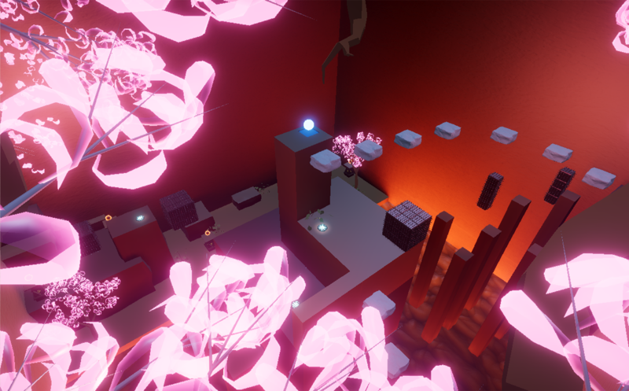
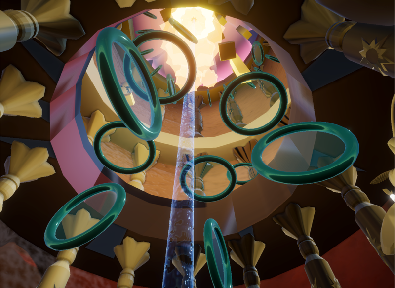
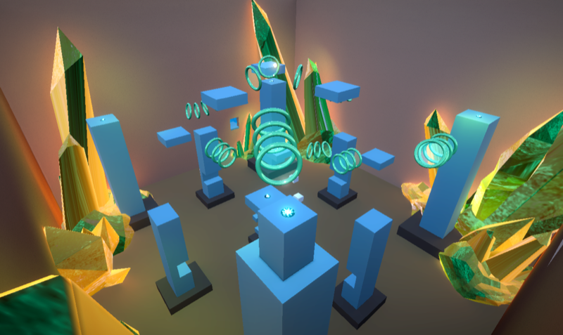
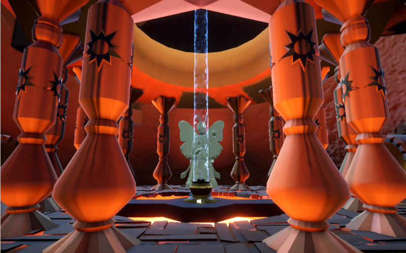
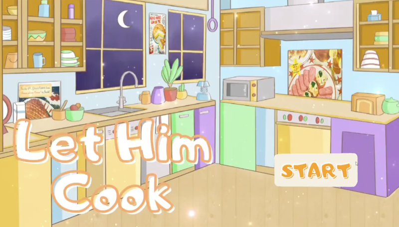
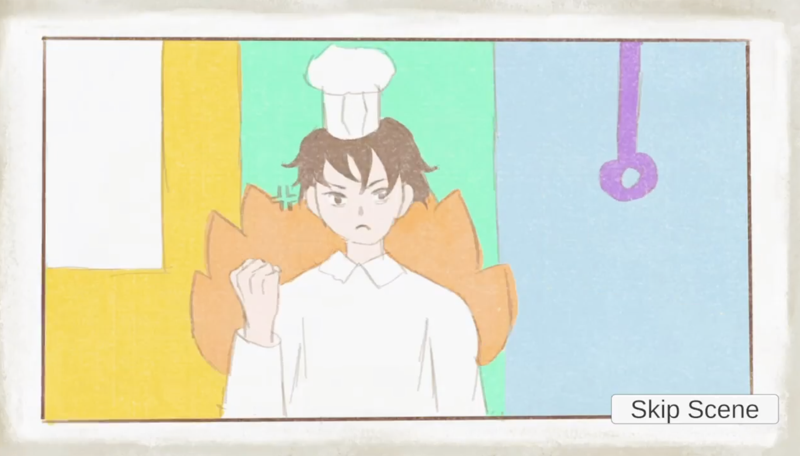
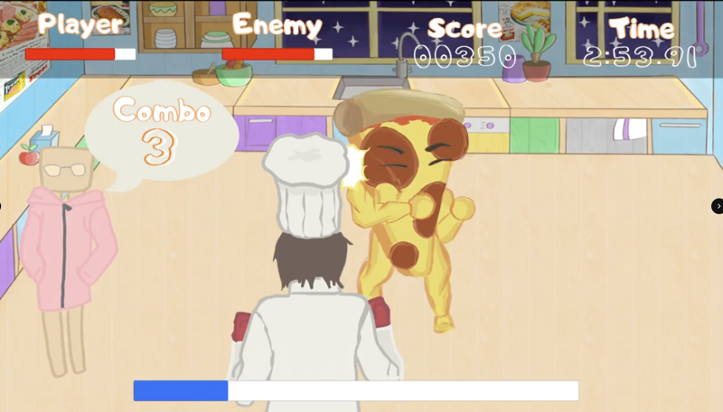
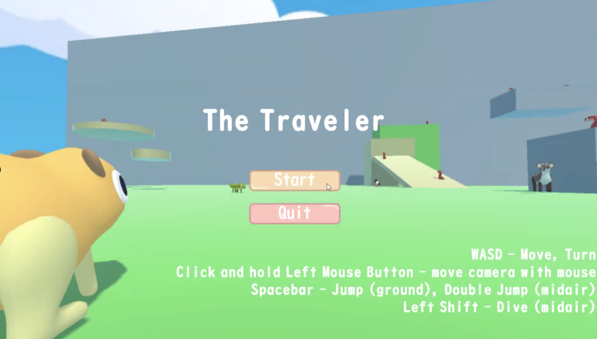
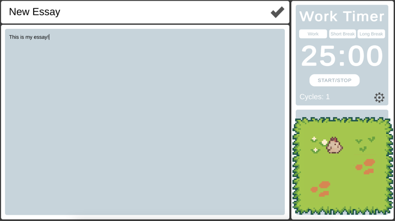

# Summer Shen

Cornell'29 and a game developer

# My Game Dev Projects
## Sun Seeker

The sun has shattered and scattered sun shards throughout the temple. Play as a little moth person called Lo. Dash, climb, and glide through many 3D platforming levels. Collect all the sun shards and ascend the tower to piece the sun back together!

**Tech:** 

**My Role:** Producer & Programmer

**Game Screenshots & Trailer**

  <!-- Images -->
  
  
  
  

  <!-- Clickable thumbnail linking to Google Drive video -->
  

**Link:** https://the-architects.itch.io/sun-seeker 

## Let Him Cook
Let Him Cook is a re-theming of the retro arcade game Punch-Out. You play as a chef fighting against food that has come to life. Defeat the food by dodging, punching, and blocking. This game also features a score counter, a special critical move, and utensil-themed referees.

**Tech:** 

**My Role:** Programmer

**Game Screenshots & Trailer**

   <!-- Images -->
  
  
  
  
  <!-- Clickable thumbnail linking to Google Drive video -->
  

## Other Games

| **Game** | **Intro** | **Trailer** |
|---------|-----------|-------------|
| **The Traveler** | A 3D platform game |  |
| **Cosmo-Combat: Mars Arena** | A real-time strategy game |  |
| **Hungry Hungry Students** | A tower defense demo |  |
| **Bug Rescue** | My first Unity game. Adventure game with NPCs |  |
| **Write Wise** | Explored gamification ideas in GTD |   |

